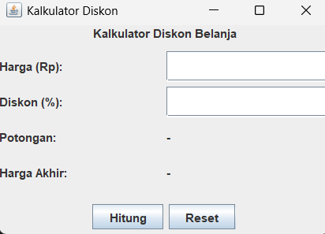
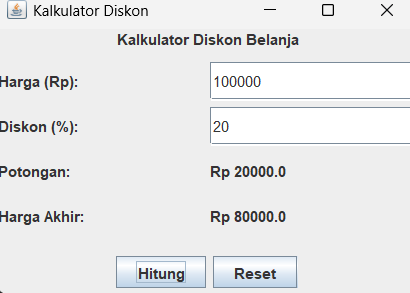

# Kalkulator Diskon

Latihan eksplorasi GUI Java untuk menghitung potongan harga dan harga akhir setelah diskon.

## Komponen GUI yang Digunakan
1. **Top-level Container**: `JFrame`, jendela utama aplikasi.
2. **Intermediate Container**: `JPanel`, mengelompokkan form input dan tombol.
3. **Atomic Component**: `JLabel`, `JTextField`, `JButton`.
4. **Layout Classes**: `BorderLayout` (frame), `GridLayout` (panel form), `FlowLayout` (panel tombol).
5. **Event Listener**: `ActionListener` (interface, tombol Hitung) dan `MouseAdapter` (adapter class, tombol Reset).

## Screenshot

